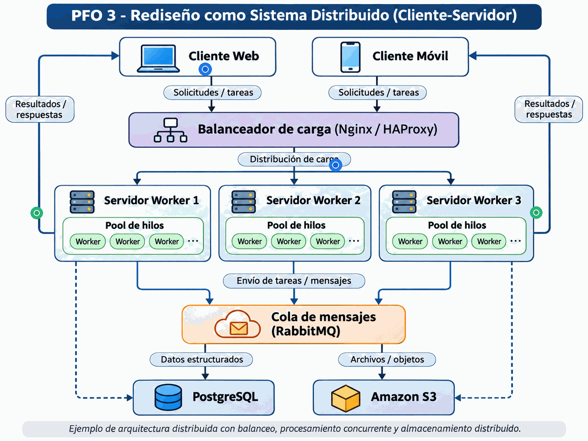
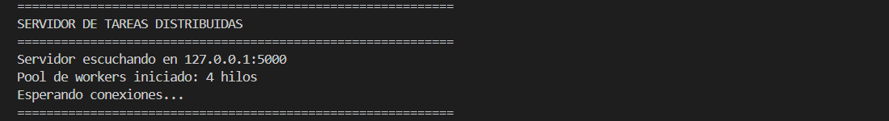
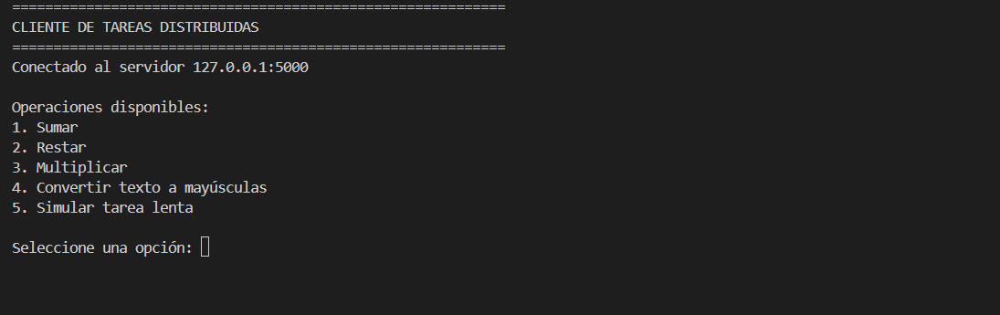
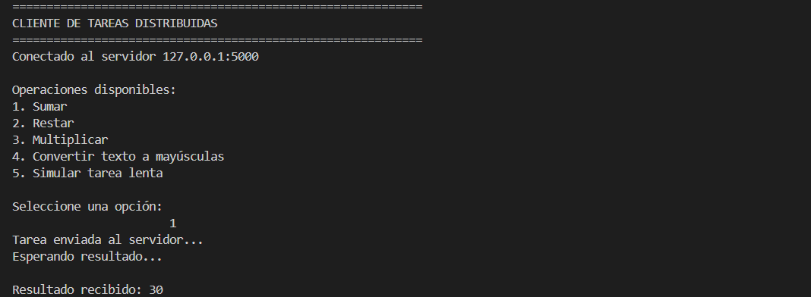
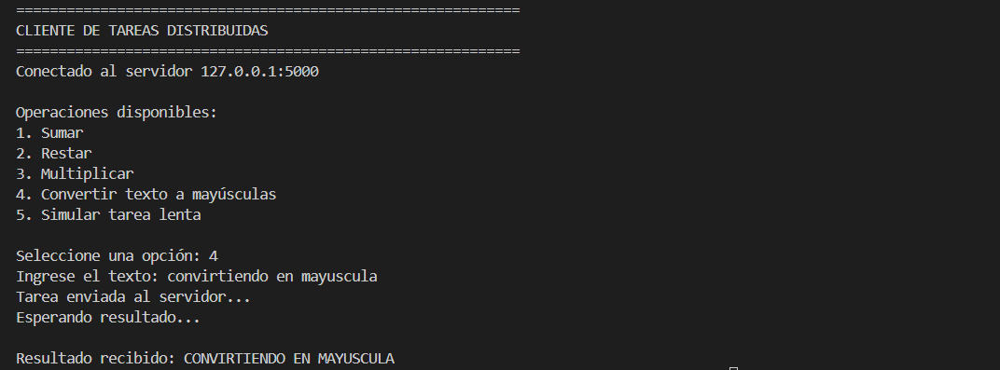
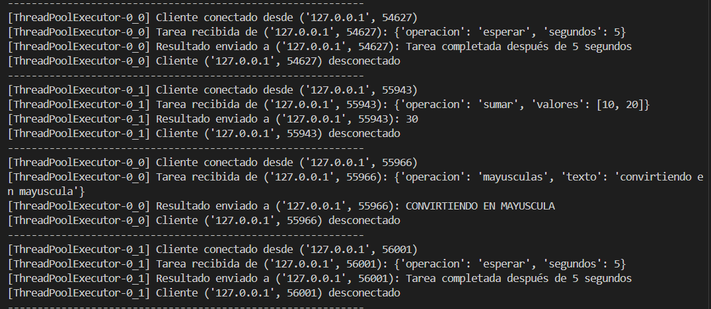

# PFO 3 - Rediseño como Sistema Distribuido (Cliente-Servidor)

## Datos del trabajo

- **Institución:** IFTS N.º 29
- **Carrera:** Tecnicatura Superior en Desarrollo de Software
- **Materia:** Programación sobre Redes
- **Trabajo:** Práctica Formativa Obligatoria N.º 3
- **Año:** 2026
- **Alumno:** Lucas Gabriel Monteras

---

## Descripción

Este proyecto implementa un sistema cliente-servidor en Python utilizando **sockets TCP**.

El cliente envía tareas al servidor utilizando mensajes en formato **JSON**. El servidor recibe las conexiones y distribuye el procesamiento mediante un **pool de workers basado en hilos**, permitiendo atender varios clientes de forma concurrente.

La implementación busca representar de manera simplificada el funcionamiento de una arquitectura distribuida, aplicando conceptos trabajados durante la materia como:

- Arquitectura cliente-servidor.
- Sockets TCP.
- Comunicación mediante JSON.
- Concurrencia.
- Multithreading.
- Pool de workers.
- Manejo de errores.
- Distribución de tareas.

---

## Arquitectura implementada

La implementación realizada funciona de la siguiente manera:

```text
                CLIENTES
                   │
                   │ TCP + JSON
                   ▼
            ┌───────────────┐
            │   SERVIDOR    │
            │  servidor.py  │
            └───────┬───────┘
                    │
                    ▼
           ThreadPoolExecutor
                    │
        ┌───────────┼───────────┐
        ▼           ▼           ▼
     Worker 1    Worker 2    Worker 3
        │           │           │
        ▼           ▼           ▼
      Tarea       Tarea       Tarea
        │           │           │
        ▼           ▼           ▼
    Resultado    Resultado    Resultado
```

El servidor tiene configurado un máximo de cuatro workers:

```python
MAX_WORKERS = 4
```

Cada worker puede procesar una conexión de cliente de manera independiente.

---

## Arquitectura distribuida propuesta

La consigna plantea una arquitectura distribuida más amplia que incorpora:

- Clientes web y móviles.
- Balanceador de carga con Nginx o HAProxy.
- Múltiples servidores.
- Pool de workers.
- RabbitMQ como cola de mensajes.
- PostgreSQL para almacenamiento de datos.
- Amazon S3 para almacenamiento de archivos.

El diagrama completo del sistema se incluye a continuación:





> El diagrama representa la arquitectura completa propuesta. La implementación práctica de este trabajo se concentra en la comunicación mediante sockets y el procesamiento concurrente con workers.

---

## Tecnologías utilizadas

- Python
- Socket TCP
- JSON
- Threading
- ThreadPoolExecutor
- Git
- GitHub

No se utilizaron dependencias externas. Todas las bibliotecas utilizadas forman parte de Python.

---

## Estructura del proyecto

```text
PFO_3_PROGRAMACION_SOBRE_REDES_LGM/
│
├── img/
│   ├── 01_servidor_iniciado.png
│   ├── 02_cliente_menu.png
│   ├── 03_tarea_suma.png
│   ├── 04_tarea_mayusculas.png
│   ├── 05_workers_concurrentes.png
│   └── 06_diagrama_arquitectura.png
│
├── .gitignore
├── cliente.py
├── README.md
└── servidor.py
```

---

# Funcionamiento

## 1. Servidor

El servidor utiliza un socket TCP:

```python
socket.socket(socket.AF_INET, socket.SOCK_STREAM)
```

Donde:

- `AF_INET` indica el uso de IPv4.
- `SOCK_STREAM` indica el uso del protocolo TCP.

El servidor se ejecuta en:

```text
127.0.0.1:5000
```

y permanece esperando nuevas conexiones.

---

## 2. Cliente

El cliente se conecta al servidor mediante TCP y permite seleccionar diferentes tareas.

Las operaciones disponibles son:

```text
1. Sumar
2. Restar
3. Multiplicar
4. Convertir texto a mayúsculas
5. Simular una tarea lenta
```

---

## 3. Comunicación mediante JSON

El cliente transforma la tarea en JSON antes de enviarla.

Ejemplo:

```json
{
  "operacion": "sumar",
  "valores": [10, 20]
}
```

El servidor recibe el mensaje, lo convierte nuevamente a una estructura de Python y procesa la operación.

La respuesta también se envía utilizando JSON:

```json
{
  "estado": "ok",
  "resultado": 30
}
```

---

## 4. Pool de workers

Para procesar múltiples clientes se utiliza:

```python
ThreadPoolExecutor
```

El servidor configura cuatro workers:

```python
with ThreadPoolExecutor(max_workers=4) as pool:
```

Cuando llega una nueva conexión:

```python
pool.submit(
    atender_cliente,
    cliente,
    direccion
)
```

la tarea se asigna a uno de los hilos disponibles.

Esto permite que el hilo principal vuelva rápidamente a `accept()` y pueda recibir nuevas conexiones.

---

## Flujo de procesamiento

```text
Cliente
   │
   │ conecta
   ▼
Servidor
   │
   │ accept()
   ▼
Pool de workers
   │
   ▼
Worker disponible
   │
   │ recibe JSON
   ▼
Procesar tarea
   │
   ▼
Generar resultado
   │
   │ JSON
   ▼
Cliente
```

---

# Ejecución

## 1. Clonar el repositorio

```bash
git clone https://github.com/LucasMonteras/PFO_3_PROGRAMACION_SOBRE_REDES_LGM.git
```

Ingresar al proyecto:

```bash
cd PFO_3_PROGRAMACION_SOBRE_REDES_LGM
```

---

## 2. Ejecutar el servidor

En una terminal:

```bash
python servidor.py
```

Deberá mostrarse:

```text
============================================================
SERVIDOR DE TAREAS DISTRIBUIDAS
============================================================
Servidor escuchando en 127.0.0.1:5000
Pool de workers iniciado: 4 hilos
Esperando conexiones...
```

---

## 3. Ejecutar el cliente

En otra terminal:

```bash
python cliente.py
```

Luego seleccionar una operación.

Ejemplo:

```text
Operaciones disponibles:
1. Sumar
2. Restar
3. Multiplicar
4. Convertir texto a mayúsculas
5. Simular tarea lenta

Seleccione una opción: 1
```

Resultado:

```text
Resultado recibido: 30
```

---

# Pruebas realizadas

## 1. Servidor iniciado

Se verifica que el servidor quede escuchando conexiones en el puerto `5000` y que el pool de cuatro workers se encuentre disponible.



---

## 2. Menú del cliente

El cliente muestra las operaciones disponibles antes de enviar una tarea.



---

## 3. Tarea de suma

Se envía una operación de suma al servidor y se recibe correctamente el resultado.



---

## 4. Conversión a mayúsculas

Se envía una tarea de procesamiento de texto y el servidor devuelve el contenido convertido a mayúsculas.



---

## 5. Procesamiento concurrente

Para comprobar el funcionamiento del pool de hilos se ejecutaron varios clientes.

La consola del servidor muestra diferentes workers atendiendo conexiones:

```text
[ThreadPoolExecutor-0_0]
[ThreadPoolExecutor-0_1]
```

Esto demuestra que distintas tareas pueden procesarse de forma concurrente sin que el servidor tenga que esperar a que termine completamente una conexión antes de comenzar otra.



---

# Manejo de errores

La implementación contempla errores básicos como:

- Servidor no disponible.
- Datos vacíos.
- JSON inválido.
- Operaciones no reconocidas.
- Errores durante la comunicación.
- Cierre de conexiones.

El cliente utiliza manejo de excepciones para evitar que el programa termine abruptamente si no puede establecer la conexión.

El servidor utiliza `try`, `except` y `finally` para garantizar el cierre correcto de cada socket.

---

# Concurrencia

La operación de prueba:

```text
Simular tarea lenta
```

mantiene ocupado un worker durante cinco segundos.

Esto permite ejecutar varios clientes simultáneamente y comprobar que otro worker puede comenzar a atender una nueva conexión mientras el anterior continúa procesando.

Ejemplo conceptual:

```text
Cliente A ──► Worker 0 ──► 5 segundos ──► Resultado

Cliente B ──► Worker 1 ──► 5 segundos ──► Resultado
```

Si el servidor fuera completamente secuencial, el segundo cliente debería esperar a que termine el primero.

Con el pool de hilos ambos pueden procesarse concurrentemente.

---

# Relación con un sistema distribuido

La implementación desarrollada representa una versión simplificada del sistema solicitado.

En una infraestructura de producción, el flujo podría ampliarse de la siguiente manera:

```text
Clientes
   │
   ▼
Nginx / HAProxy
   │
   ▼
Múltiples servidores
   │
   ▼
Pools de workers
   │
   ▼
RabbitMQ
   │
   ├── PostgreSQL
   └── Amazon S3
```

El balanceador permitiría distribuir las conexiones entre distintos servidores.

RabbitMQ permitiría desacoplar la recepción de tareas de su procesamiento.

PostgreSQL podría utilizarse para almacenar información estructurada y S3 para archivos u objetos.

En este PFO se implementa específicamente la comunicación mediante sockets y la distribución concurrente de tareas utilizando workers.